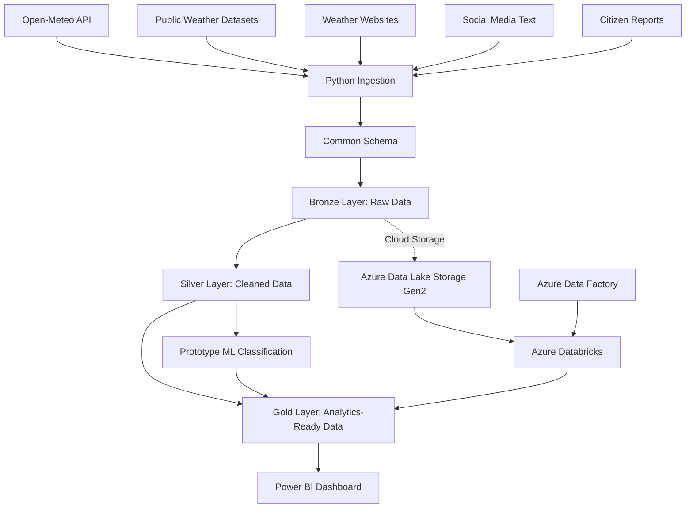

# 🌦️ National Weather Big Data Analytics Platform
### SIH 2026 | Problem Statement: SIH26069 | Cloud Data Engineering & Weather Analytics

An end-to-end weather data engineering platform designed to collect, standardize, process, and analyze weather-related information from multiple sources. The project demonstrates a multi-layer data pipeline, cloud-based processing with Azure Databricks, orchestration with Azure Data Factory, prototype machine learning, and interactive analytics through Power BI.

**Project Repository:** [National Weather Big Data Analytics Platform — GitHub](https://github.com/UJJAWALSINGHRAJ/National-Weather-Big-Data-Analytics-Platform-SIH26069)

---

## 📌 Table of Contents

- [Project Overview](#-project-overview)
- [Problem Statement](#-problem-statement)
- [Key Features](#-key-features)
- [System Architecture](#-system-architecture)
- [Technology Stack](#-technology-stack)
- [Data Sources](#-data-sources)
- [Data Engineering Workflow](#-data-engineering-workflow)
- [Machine Learning Prototype](#-machine-learning-prototype)
- [Power BI Dashboard](#-power-bi-dashboard)
- [Project Structure](#-project-structure)
- [Getting Started](#-getting-started)
- [Azure Cloud Architecture](#-azure-cloud-architecture)
- [Results and Validation](#-results-and-validation)
- [Limitations and Responsible Use](#-limitations-and-responsible-use)
- [Future Enhancements](#-future-enhancements)
- [Team](#-team)
- [References](#-references)

---

## 🚀 Project Overview

The National Weather Big Data Analytics Platform is an academic project developed for Smart India Hackathon (SIH) problem statement **SIH26069**. It explores how heterogeneous weather and disaster-related data can be integrated into a common analytics workflow.

The platform brings together API responses, public datasets, website information, social-media text, and citizen reports. Python-based ingestion modules collect the data, a common-schema transformation standardizes records, and Bronze, Silver, and Gold processing layers organize data for downstream analytics.

Azure Databricks supports cloud-side data processing, Azure Data Factory provides pipeline orchestration, and Power BI presents analytical outputs through an interactive dashboard.

### Project Objectives

- Integrate data from multiple weather-related sources.
- Standardize heterogeneous records into a common schema.
- Organize processing through Bronze, Silver, and Gold layers.
- Generate analytical datasets for weather events and rainfall analysis.
- Experiment with text classification for weather/disaster-related social-media content.
- Present selected outputs through Power BI.
- Demonstrate an end-to-end data engineering workflow using Azure services.

## 🎯 Problem Statement

Weather and disaster-related information can be distributed across APIs, public datasets, websites, social platforms, and citizen submissions. These sources may differ in format, structure, update frequency, and reliability.

This project demonstrates a unified processing workflow that helps organize this information for analysis. It is a prototype platform for data integration and analytics—not a replacement for official meteorological forecasts, emergency services, or government warning systems.

## ✨ Key Features

- **Multi-source ingestion:** Python modules for API data, public datasets, website content, social-media text, and citizen reports.
- **Common-schema transformation:** A shared structure for combining records from different sources.
- **Medallion-style processing:** Bronze, Silver, and Gold layers for raw, cleaned, and analytics-ready data.
- **Cloud processing:** Azure Data Lake Storage Gen2 and Azure Databricks.
- **Pipeline orchestration:** Azure Data Factory configured to trigger a Databricks job.
- **Prototype text classification:** TF-IDF features and Logistic Regression for categorizing social-media text.
- **Analytical outputs:** Gold datasets for event analytics, source analytics, state rainfall, and ML predictions.
- **Interactive reporting:** Power BI dashboard for exploring processed outputs.

## 🏗️ System Architecture



The architecture represents the intended processing flow. Individual sources and cloud components may operate on different snapshots or execution schedules.

## 🧰 Technology Stack

| Category | Technologies |
|---|---|
| Programming | Python, SQL |
| Data Processing | pandas, schema standardization, cleaning and transformation scripts |
| Cloud Storage | Azure Data Lake Storage Gen2 |
| Cloud Processing | Azure Databricks, Spark/PySpark where implemented |
| Orchestration | Azure Data Factory |
| Machine Learning | scikit-learn, TF-IDF, Logistic Regression |
| Visualization | Microsoft Power BI |
| Version Control | Git, GitHub |

## 🌐 Data Sources

The project is designed to demonstrate integration of multiple types of information.

| Source | Purpose | Reference |
|---|---|---|
| Open-Meteo | Weather API data | [open-meteo.com](https://open-meteo.com/) |
| India Meteorological Department | Rainfall-related website information | [IMD Rainfall Information](https://mausam.imd.gov.in/responsive/rainfallinformation.php) |
| Public IMD rainfall dataset | Historical rainfall analysis | [IMD official website](https://mausam.imd.gov.in/) |
| Social-media text dataset | Prototype text classification | [Kaggle](https://www.kaggle.com/) |
| Citizen reports | Example user-submitted weather observations | Project input data |

**Data quality note:** Source formats, timestamps, geographic coverage, and reliability vary. Social-media training data may not be specific to India or weather. Citizen reports are not independently verified unless an explicit verification process is implemented.

## 🔄 Data Engineering Workflow

### 1. Data Ingestion

Dedicated Python modules collect or load information from configured sources:

- `api_ingestion.py`
- `dataset_ingestion.py`
- `website_ingestion.py`
- `social_media_ingestion.py`
- `citizen_report_ingestion.py`

### 2. Common Schema

The transformation layer aligns source records to a shared structure. Depending on source availability, fields can include source name, timestamp, location, text, rainfall values, event category, and record metadata.

Missing or unavailable fields should remain null or be explicitly marked rather than fabricated.

### 3. Bronze Layer

The Bronze layer retains ingested records in a raw or minimally transformed form. This layer supports traceability and allows later transformations to be reproduced from source data.

### 4. Silver Layer

The Silver layer applies cleaning and standardization, such as handling missing values, normalizing fields, and preparing records for analysis. Actual cleaning rules depend on the source and implemented scripts.

### 5. Gold Layer

The Gold layer contains analytics-oriented outputs. Project outputs include datasets for:

- Weather/event analytics
- Source-level analytics
- State rainfall analysis
- Machine learning predictions

### 6. Cloud Orchestration

Azure Data Factory was configured to orchestrate an Azure Databricks job. The exact execution state and latest run results should be checked in the Azure portal before describing the workflow as continuously automated.

### 7. Visualization

Power BI consumes selected analytical outputs to present trends, summaries, and model predictions. Dashboard values reflect the underlying data snapshot and refresh status.

## 🤖 Machine Learning Prototype

The project includes an experimental text-classification workflow using **TF-IDF** and **Logistic Regression**.

### Processing Steps

1. Load the processed social-media text dataset.
2. Prepare text features and target labels.
3. Convert text into numerical features using TF-IDF.
4. Split the dataset into training and testing subsets.
5. Train a Logistic Regression classifier.
6. Evaluate predictions using classification metrics.
7. Generate category predictions and confidence estimates for downstream analysis.

Example category labels include rainfall, flooding, thunderstorms, heatwaves, fog, dust storms, strong winds, and other content, depending on the implemented label mapping.

The model is an exploratory classifier. It does not predict future weather conditions. Model confidence is not the same as the probability that a real-world weather event is occurring.

## 📊 Power BI Dashboard

The Power BI dashboard is designed to present selected Gold-layer outputs in an accessible analytical format.

Potential dashboard views include:

- Event and source summaries
- Rainfall analysis by state or region
- Distribution of classified social-media content
- Machine-learning prediction summaries

**Dashboard file:** `dashboard/National_Weather_Big_Data_Analytics_Platform.pbix`

Open the PBIX file using [Microsoft Power BI Desktop](https://powerbi.microsoft.com/desktop/). Some visuals may require the original data files, supported connectors, or updated credentials. Never commit passwords, access tokens, or private connection strings.

## 📁 Project Structure

```text
National-Weather-Big-Data-Analytics-Platform-SIH26069/
├── README.md
├── run_pipeline.py
├── .gitignore
├── admin_panel/
│   └── citizen_report_form.py
├── dashboard/
│   └── National_Weather_Big_Data_Analytics_Platform.pbix
├── data/
│   ├── raw/
│   ├── sample/
│   ├── bronze/
│   ├── silver/
│   ├── processed/
│   └── gold/
├── ingestion/
│   ├── api_ingestion.py
│   ├── citizen_report_ingestion.py
│   ├── dataset_ingestion.py
│   ├── social_media_ingestion.py
│   └── website_ingestion.py
├── notebooks/
└── src/
    ├── analytics/
    │   └── gold_layer.py
    ├── cleaning/
    │   ├── bronze_layer.py
    │   └── silver_layer.py
    ├── ml/
    │   └── weather_ml.py
    ├── transformation/
    │   └── common_schema.py
    └── validation/
```

Generated datasets and raw data may be excluded from GitHub by `.gitignore` to keep the repository smaller and avoid redistributing data without checking its licence. The folder structure above describes the intended layout; empty or ignored folders may not appear in a GitHub checkout.

## 💻 Getting Started

### Prerequisites

- Python 3.10 or a compatible version supported by the project's dependencies
- Git
- Internet access for sources that require it
- Optional: Azure account with suitable permissions
- Optional: Azure Databricks workspace and Power BI Desktop

### 1. Clone the Repository

```bash
git clone https://github.com/UJJAWALSINGHRAJ/National-Weather-Big-Data-Analytics-Platform-SIH26069.git
cd National-Weather-Big-Data-Analytics-Platform-SIH26069
```

### 2. Create a Virtual Environment

Windows PowerShell:

```powershell
python -m venv .venv
.\.venv\Scripts\Activate.ps1
```

### 3. Install Dependencies

Install the packages required by the current scripts. A dependency file such as `requirements.txt` should be added to the repository to make this step reproducible.

Common packages used by the project include:

```powershell
pip install pandas requests scikit-learn
```

Additional dependencies may be needed depending on the specific ingestion modules and dashboard integration.

### 4. Configure Data and Credentials

- Place permitted input datasets in the expected `data/raw/` subfolders.
- Configure source URLs and paths according to the scripts.
- Store secrets in environment variables or a local `.env` file.
- Do not commit `.env`, access keys, SAS tokens, or cloud credentials.

### 5. Run the Local Pipeline

```powershell
python run_pipeline.py
```

The pipeline reads configured source inputs and executes the implemented ingestion and processing stages. Successful execution depends on available datasets, network access, installed dependencies, and valid configuration.

## ☁️ Azure Cloud Architecture

The cloud workflow uses these Azure services:

### Azure Data Lake Storage Gen2
Provides hierarchical storage for data organized by processing layer.

### Azure Databricks
Runs notebook-based data processing and supports distributed processing where implemented.

### Azure Data Factory
Orchestrates configured pipeline activities and invokes the Databricks job.

### Power BI
Consumes analytical outputs for reporting and interactive exploration.

**Reproducibility note:** Azure resources are not recreated by cloning the repository. A user must configure their own storage, workspace, permissions, linked services, and credentials.

Official documentation:

- [ADLS Gen2](https://learn.microsoft.com/azure/storage/blobs/data-lake-storage-introduction)
- [Azure Data Factory](https://learn.microsoft.com/azure/data-factory/introduction)
- [Azure Databricks](https://learn.microsoft.com/azure/databricks/)
- [Power BI](https://learn.microsoft.com/power-bi/)

## 📈 Results and Validation

Recorded development runs demonstrated the local and cloud processing workflow:

- One local run processed approximately **11,806 combined records** across the configured stages.
- A separate Databricks run processed approximately **12,584 records**.
- A Databricks ML experiment on a subset of social-media data reported approximately **73.53% test accuracy** in one run.

These figures are run-specific, not guaranteed benchmark results. Counts can change with input snapshots, filtering, and pipeline changes. The ML result should be interpreted alongside class distribution, data quality, and the suitability of the labels.

For a stronger evaluation, report the exact source snapshot, train/test split, per-class precision and recall, confusion matrix, and baseline performance.

## ⚠️ Limitations and Responsible Use

- The platform is an academic prototype, not an official forecasting or warning service.
- Input sources may differ in quality, timeliness, geographic coverage, and licensing.
- Social-media text may be noisy, duplicated, irrelevant, or geographically mismatched.
- Keyword-derived labels can introduce bias into model evaluation.
- Citizen-submitted reports require validation before operational use.
- Cloud resources, data connectors, and scheduled triggers may incur costs.
- Do not publish personal information, private reports, secrets, or restricted datasets.

## 🔮 Future Enhancements

- Add robust schema and data-quality validation.
- Introduce automated deduplication and incremental loading.
- Store data lineage and ingestion timestamps.
- Improve the ML workflow with verified labels, class-balanced evaluation, and model monitoring.
- Add geographic validation and source reliability scoring.
- Implement citizen-report review and moderation.
- Add reproducible environment setup, unit tests, and CI checks.
- Document cloud deployment and cost controls.
- Include dashboard screenshots and sample, licence-compliant datasets.

## 👥 Team

**Ujjawal Kumar** — Data Engineering  
**Sakshi Kumari** — AI/ML and Dashboard

**Institution:** Jodhpur Institute of Engineering and Technology (JIET), Jodhpur, Rajasthan, India  
**Project:** Smart India Hackathon 2026 — SIH26069

## 📚 References

- [Open-Meteo](https://open-meteo.com/)
- [India Meteorological Department](https://mausam.imd.gov.in/)
- [IMD Rainfall Information](https://mausam.imd.gov.in/responsive/rainfallinformation.php)
- [Kaggle](https://www.kaggle.com/)
- [Azure Data Lake Storage Gen2 Documentation](https://learn.microsoft.com/azure/storage/blobs/data-lake-storage-introduction)
- [Azure Data Factory Documentation](https://learn.microsoft.com/azure/data-factory/introduction)
- [Azure Databricks Documentation](https://learn.microsoft.com/azure/databricks/)
- [Microsoft Power BI Documentation](https://learn.microsoft.com/power-bi/)

---

**Built as an academic data engineering prototype for SIH2026.**  
If you find the project useful, explore the repository, review the implementation, and adapt the architecture for your own learning projects.
